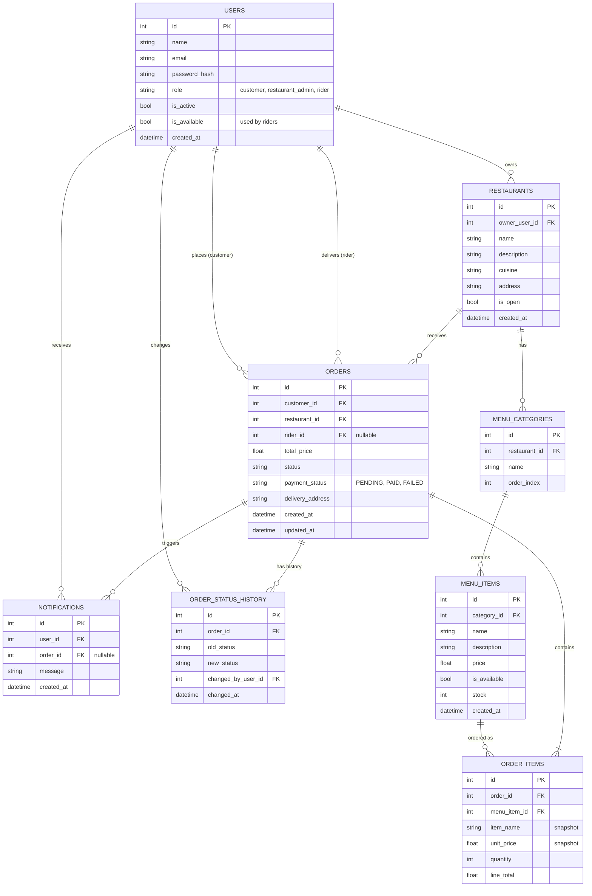

# SmartFoodOps – ERD

**Notes**

- `orders.status` holds one of: PLACED, ACCEPTED, REJECTED, PREPARING, READY, ASSIGNED, PICKED_UP, DELIVERED, CANCELLED.
- `order_items` copies the name and unit price when the order is placed, so old orders do not change if the menu changes.
- A user is a customer, a restaurant admin or a rider depending on `role`. `orders.customer_id` and `orders.rider_id` both point to `users`.