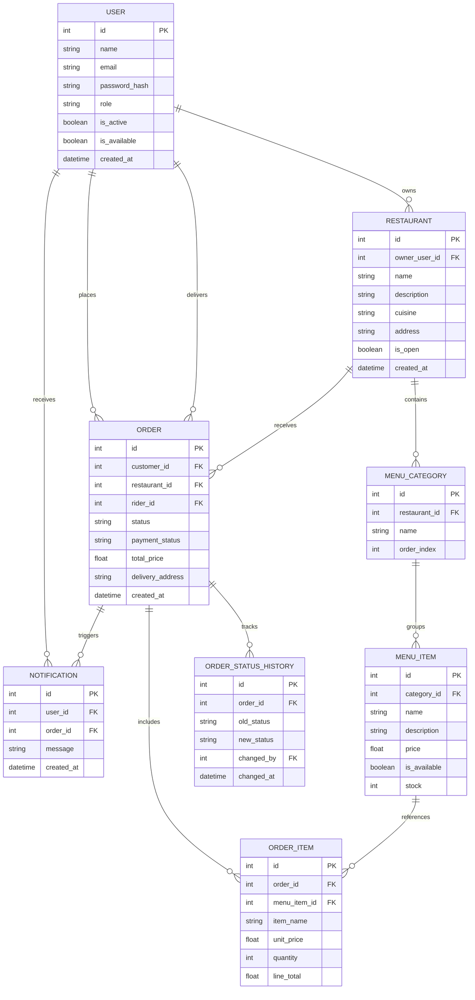

# SmartFoodOps - System Architecture & Design

## 1. System Overview
SmartFoodOps is an operations-focused backend REST API built using FastAPI, SQLAlchemy, and SQLite. It handles the complete food delivery lifecycle, including role-based authentication (RBAC), multi-tenant restaurant and menu management, server-side dynamic pricing, sequential order state machine transitions, automated rider dispatching, platform analytics, and TF-IDF intelligent search retrieval.

---

## 2. Order Lifecycle State Machine
The order lifecycle strictly enforces valid sequential status transitions. Skipping steps or illegal transitions immediately reject the request with an **HTTP 409 Conflict** error.

```text
[PLACED]
   │
   ▼
[ACCEPTED]      (Action by: Restaurant Admin)
   │
   ▼
[PREPARING]     (Action by: Restaurant Admin)
   │
   ▼
[READY]         (Action by: Restaurant Admin)
   │
   ▼
[ASSIGNED]      (Auto-dispatch / Manual First-Available Rider)
   │
   ▼
[PICKED_UP]     (Action by: Assigned Rider only)
   │
   ▼
[DELIVERED]     (Action by: Assigned Rider only)
```

*Note: Order cancellation is permitted only when an order is in pre-delivery states (before `PICKED_UP`).*

---

## 3. Rider Assignment & Delivery Logic
1. **Availability Toggle:** Riders possess an `is_available` boolean flag. Riders can manually toggle their duty availability (`/riders/me/availability`).
2. **First-Available Dispatch:** When an order reaches `READY` status, the system queries the active rider pool for the first available rider (`is_available == True`).
3. **Status Lock & Release:**
   - Once assigned, the rider's `is_available` flag is automatically updated to `False`.
   - When the assigned rider marks the delivery as `DELIVERED`, the rider's `is_available` flag is immediately reset to `True`.
4. **Actor Guard (Cross-Rider Protection):** Only the specific rider assigned to that order (`order.rider_id == current_user.id`) has authorization to update status to `PICKED_UP` and `DELIVERED` (preventing unauthorized cross-rider manipulation with HTTP 403 Forbidden).

---

## 4. Entity-Relationship Diagram (ERD)



---

## 5. Architectural Design Decisions
1. **Server-Side Dynamic Pricing Snapshot:** To prevent client-side cart tampering, unit prices and line totals are strictly queried and computed from the database at order creation time. Immutable snapshots are recorded inside `order_items`.
2. **Auditability & Traceability:** Every order transition creates an append-only row in `order_status_history` recording the exact timestamp, actor ID, and state change for audit trails.
3. **Retrieval-Augmented Intelligent Search:** Scikit-learn's `TfidfVectorizer` and cosine similarity score menu items against user search queries without external vector database dependencies, enforcing strict database context pass-through to avoid hallucinations.