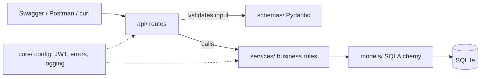
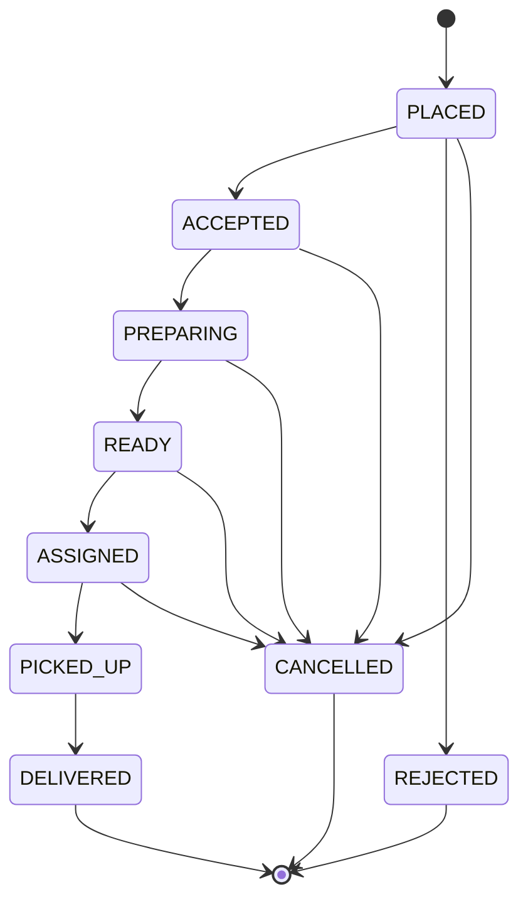

# SmartFoodOps – Design Notes

## 1. Overview

SmartFoodOps is a FastAPI backend with a SQLite database. Three roles use it:
**customer**, **restaurant_admin** and **rider**. Permissions are always checked on the
server: first the role, then (where needed) ownership, for example "this admin owns this restaurant".

## 2. Module structure

| Folder | What it contains |
|--------|------------------|
| `app/api/` | Routes only. A route checks login, reads input, calls a service and returns the result. |
| `app/services/` | Business rules: pricing, stock, status changes, rider assignment, notifications, analytics, search. |
| `app/models/` | Database tables. |
| `app/schemas/` | Request and response shapes with validation. |
| `app/core/` | Settings (`.env`), password hashing and JWT, error handlers, logging setup. |

## 3. Order status flow

All allowed moves live in one place: the `VALID_TRANSITIONS` map in
`app/services/order_service.py`, used by `update_order_status()`. Anything not in the map
returns **409 Conflict**. Every change adds a row to `order_status_history`
(`old_status`, `new_status`, `changed_by_user_id`, `changed_at`).

Who can make each change:

| Change | Allowed user |
|--------|--------------|
| `ACCEPTED`, `REJECTED`, `PREPARING`, `READY` | admin of that restaurant only |
| `ASSIGNED` | admin of that restaurant, using `POST /orders/{id}/assign-rider` (not through `PATCH`) |
| `PICKED_UP`, `DELIVERED` | the assigned rider only |
| `CANCELLED` (before `PICKED_UP`) | the customer who placed the order, or the admin of that restaurant |

If the payment is simulated as failed, the order is saved as `CANCELLED` with `payment_status = FAILED`.

## 4. Rider assignment rule

1. A rider has an `is_available` flag.
2. When an order is `READY`, the restaurant admin calls `POST /orders/{id}/assign-rider`.
   The system picks the **first available rider** (lowest id). The admin may also pass a `rider_id`.
3. The order becomes `ASSIGNED` and that rider becomes **unavailable**.
4. When the order is `DELIVERED` (or cancelled), the rider becomes **available** again.
5. If no rider is free, the order stays `READY` and the API returns **409** with a clear message.
6. A rider cannot switch availability while a delivery is `ASSIGNED` or `PICKED_UP`.

## 5. Pricing, stock and payment

- The client sends only item ids and quantities. The server reads prices from the database and
  calculates the total. A `total` sent by the client is ignored.
- Each `order_items` row stores `item_name`, `unit_price`, `quantity` and `line_total`, so old orders
  stay correct even if the menu price changes later.
- Before an order is created the server checks: cart not empty, restaurant open, every item belongs to
  that restaurant, every item is available, quantity is above 0 and not more than the stock.
- Stock is reduced when the order is placed with a successful payment. It is added back when the order is cancelled or rejected.
- Payment is simulated with `payment_status` (`PAID` or `FAILED`). The request field `simulate_payment`
  lets a tester choose the result (default `PAID`).

## 6. Notifications, logging and errors

- A `notifications` row is written in the same request when something important happens (order placed,
  accepted, rejected, ready, rider assigned, picked up, delivered, cancelled). `GET /notifications/` shows the user's own rows.
- Python `logging` is used everywhere (no `print`). Important actions log ids such as `order_id`, `rider_id` and `user_id`.
  Each request also gets a short request id (`X-Request-ID` header) in the logs.
- Errors share one JSON shape. Stack traces, SQL errors, password hashes and tokens are never returned.
  Unexpected errors return a plain `500 Internal server error` and the details go only to the log.

## 7. How the search works (retrieval in simple words)

*Retrieval* means finding the most useful stored information for a question.

1. For every available menu item of an **open** restaurant we build one text: name + description +
   category + cuisine.
2. **TF-IDF** turns each text into numbers. Words that are rare and meaningful (like "biryani") get a
   higher weight than very common words (like "the").
3. The query ("spicy chicken under 500") is turned into numbers in the same way. The words "under 500" are
   removed from the text and used as a price filter.
4. **Cosine similarity** gives each item a score from 0 to 1 (how close it is to the query). Items below 0.05 are dropped.
5. Items are sorted by score and the top 5 are returned with the restaurant, price, score and `matched_terms`
   (the query words that were found), so you can see why an item matched.

The food assistant (`POST /assistant/recommend`) uses **the same search function** and only builds a
sentence from the results. It never mentions a menu item that was not found in the database.

## 8. Main design decisions

1. **One status field and one transition map.** Status rules are in one place instead of being copied into
   several routes. This avoids the "different rules in different routes" mistake.
2. **Server-side pricing with a price snapshot.** The client cannot change prices, and history stays correct.
3. **Thin routes, logic in services.** Routes are easy to read and the services can be tested on their own.
4. **Ownership is checked separately from role.** Being a restaurant admin does not allow editing every restaurant.
5. **Analytics only for your own restaurants.** There is no platform admin role in this edition, so showing all
   restaurants to every admin would leak other restaurants' data.
6. **Items that appear in old orders cannot be deleted** (409). The admin marks them unavailable instead. This keeps order history intact.

## 9. Limits (on purpose)

No concurrency locking for rider assignment, no Alembic migrations, no Docker, no refresh tokens, and SQLite instead of PostgreSQL.